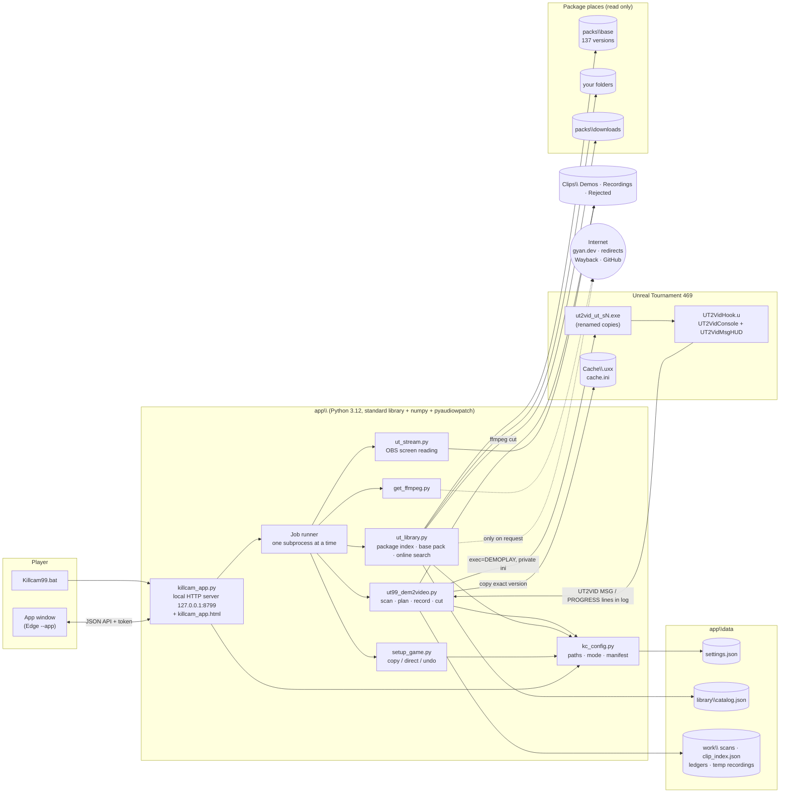
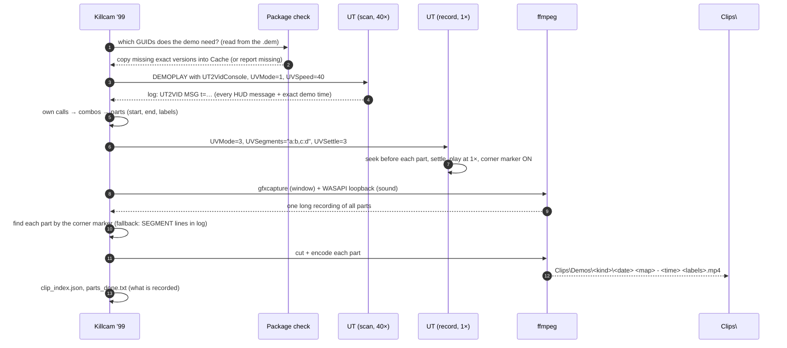
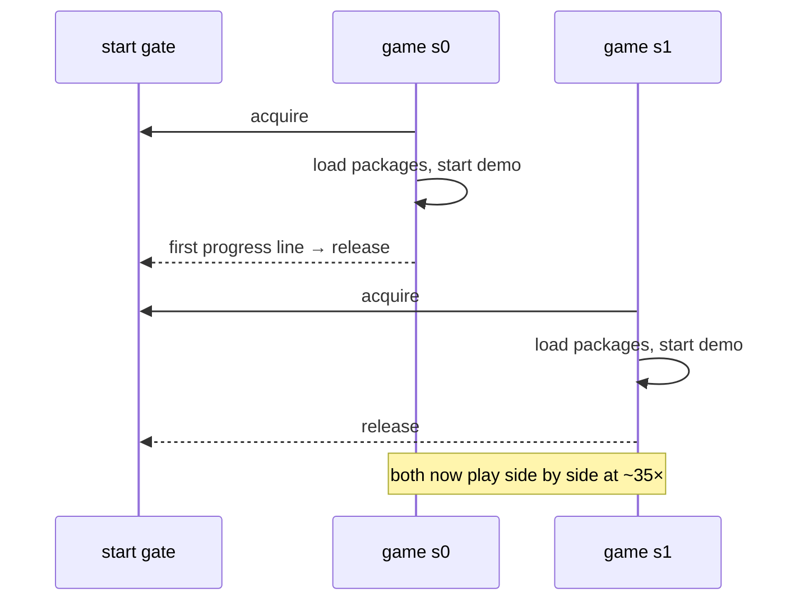
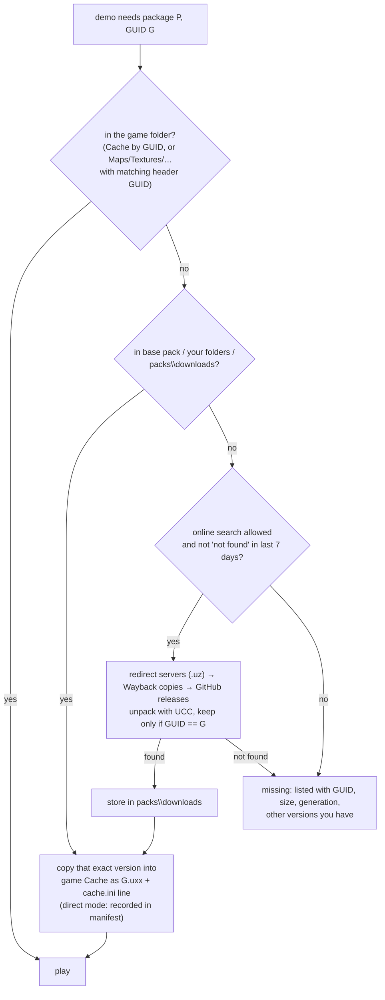
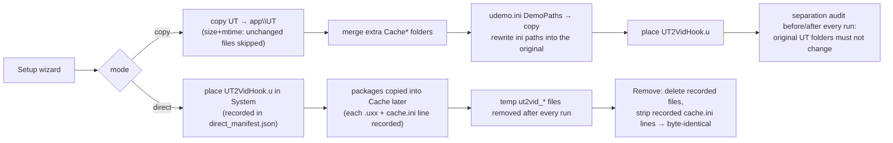

<div align="center">

# Killcam '99

**Turns your Unreal Tournament (UT99) demos and gameplay recordings into kill clips, automatically.**

Multi Kills · Monster Kills · Ludicrous · Holy Shit · Godlike sprees · flag returns and captures


-3776ab)


</div>

---

## Contents

- [What Killcam '99 does](#what-killcam-99-does)
- [Highlights](#highlights)
- [Getting started](#getting-started)
  - [What you need](#what-you-need)
  - [Option A: download the ready-to-run release](#option-a-download-the-ready-to-run-release)
  - [Option B: run it from this repository](#option-b-run-it-from-this-repository)
  - [The first start: the setup wizard](#the-first-start-the-setup-wizard)
  - [Your first clips, step by step](#your-first-clips-step-by-step)
- [User guide](#user-guide)
  - [Demos](#demos)
  - [Recordings (OBS / Streamlabs)](#recordings-obs--streamlabs)
  - [Clips](#clips)
  - [Packages](#packages)
  - [Options](#options)
  - [Help, keys, console](#help-keys-console)
  - [Drag and drop, text menu, command line](#drag-and-drop-text-menu-command-line)
  - [Updating and uninstalling](#updating-and-uninstalling)
- [How it works](#how-it-works)
  - [The big picture](#the-big-picture)
  - [Architecture diagram](#architecture-diagram)
  - [From demo to clip: the pipeline](#from-demo-to-clip-the-pipeline)
  - [The in-game add-on (UT2VidHook)](#the-in-game-add-on-ut2vidhook)
  - [Parallel scans](#parallel-scans)
  - [Recording a clip](#recording-a-clip)
  - [Clips from stream recordings](#clips-from-stream-recordings)
  - [Packages: exact versions by GUID](#packages-exact-versions-by-guid)
  - [The two setup modes](#the-two-setup-modes)
  - [The app: a local web window](#the-app-a-local-web-window)
  - [Folder layout and data files](#folder-layout-and-data-files)
- [Design decisions and crossroads](#design-decisions-and-crossroads)
- [Repository layout](#repository-layout)
- [Building a release](#building-a-release)
- [Developing](#developing)
- [Reference](#reference)
  - [settings.json](#settingsjson)
  - [Command line options](#command-line-options)
  - [Log messages worth knowing](#log-messages-worth-knowing)
- [Troubleshooting](#troubleshooting)
- [FAQ](#faq)
- [Known limitations and roadmap](#known-limitations-and-roadmap)
- [Privacy: what goes online](#privacy-what-goes-online)
- [Contributing](#contributing)
- [License, third-party content and fair use](#license-third-party-content-and-fair-use)

---

## What Killcam '99 does

Unreal Tournament can record a **demo** of every match you play (`demorec` in the console, or automatically with
many server setups). A demo is not a video: it is a recording of the network traffic of the match, and only the
game engine itself can turn it back into pictures. That makes demos tiny and perfect, but useless for sharing
on YouTube, Discord or social media until someone sits through the whole match with a screen recorder running.

**Killcam '99 does that for you, and only for the moments that matter.** It:

1. **plays each demo in the background at about 40× speed** to find *your* big moments: the announcer calls
   (Multi Kill, Monster Kill, Godlike ...), your flag returns and captures, killing the enemy flag carrier;
2. **plays only those moments again at normal speed** and records picture and sound;
3. **cuts each moment into a clip** with a few seconds of build-up and aftermath, named after the match, the map,
   the time and what happened, and sorts it into a folder per kind of moment;
4. lets you **review** the clips in its own window: keep the good ones, reject the rest.

It does the same for gameplay you recorded with **OBS or Streamlabs**: it *reads the kill messages from the
picture* and cuts the clips out of the recording. No demo, no game, no sound analysis needed.

And because a demo only plays with the **exact version** of every map, mod and texture the server used, it also
manages those **packages**: it knows which versions every demo needs, finds them in your folders, in a shipped
base pack, or online, and tells you precisely (down to the GUID) what is still missing.

## Highlights

| | |
|---|---|
| **Only your moments** | Only *your own* announcer calls count; other players' sprees never make a clip. |
| **Fast** | Kill-finding runs at ~35–40× real time, several demos side by side. A 15-minute demo is searched in under 30 seconds. |
| **Background recording** | Uses ffmpeg's Windows Graphics Capture (`gfxcapture`, ffmpeg 8.1+): you can keep working while it records. |
| **OBS / Streamlabs** | Cuts clips straight from stream recordings by reading the on-screen kill messages (Windows' built-in OCR). |
| **Exact packages** | GUID-exact package tracking, a 137-version base pack, your own folders, and online search (redirect servers, Wayback Machine, GitHub releases). |
| **Safe with your game** | Either a separate copy of UT (your folder is only read), or your own folder with a byte-for-byte undo. |
| **Self-contained** | Unzip and double-click. Python is bundled; ffmpeg is downloaded once by the setup. Nothing is installed on the PC. |
| **Plain app window** | A local, offline web UI in its own Edge app window: Demos, Recordings, Clips, Packages, Options, Help. |

---

## Getting started

### What you need

- **Windows 10 or 11**, 64-bit.
- **Unreal Tournament** (original or GOTY) with the **[OldUnreal 469 patch](https://www.oldunreal.com)**.
  The patch includes *udemo*, which Killcam '99 relies on. The OldUnreal site also offers a complete installer
  that downloads the game from archive.org with Epic's consent.
- **Disk space**: about 600 MB for Killcam '99 itself (most of it the base pack and the bundled Python), plus
  the size of your UT folder (usually 1–3 GB) if you choose *Make a separate copy*, plus your clips.
- **Internet once**, to download ffmpeg (about 100 MB) during the setup. Searching online for missing packages
  is optional.

### Option A: download the ready-to-run release

1. Go to **[Releases](../../releases)** and download `Killcam99-<version>.zip`.
2. Unzip it anywhere you like (your Documents, a second drive), but **not inside your UnrealTournament folder**.
3. Double-click **`Killcam99.bat`**.
   Windows may say *"Windows protected your PC"* because the tool is not signed with a paid certificate:
   click **More info → Run anyway**.
4. The setup wizard opens (see [below](#the-first-start-the-setup-wizard)).

After unzipping you see only this:

```
Killcam99\
  Killcam99.bat     start here (files can also be dropped on it)
  README.txt        the manual for players
  app\              everything else (hidden after the first start)
```

`Clips\` appears next to them on the first start.

### Option B: run it from this repository

The repository has exactly the installed layout, so a clone runs as-is; it just uses *your* Python instead of
the bundled one.

```bash
git clone https://github.com/fnlz-cybs/killcam99.git
```

```bash
py -3 -m pip install numpy pyaudiowpatch
```

Then double-click `Killcam99.bat` in the cloned folder. It looks for `app\python\python.exe` first and falls back
to `py -3` / `python`. Python 3.10 or newer works; the release bundles 3.12.

> **Note:** the clone is about 530 MB because the base pack (`app/packs/base`) is committed as plain files.
> To build the same self-contained zip as the release, see [Building a release](#building-a-release).

### The first start: the setup wizard

The wizard has four steps. You can run it again any time from **Options → Game → Open setup**.

**1 · Find Unreal Tournament.** Killcam '99 lists the UT folders it finds (registry, common install paths, your
Desktop). Pick the folder you play from (the one whose `System` folder holds `UnrealTournament.exe`), or use
*Browse*. It checks that it really is UT with udemo (the 469 patch).

**2 · How should Killcam '99 use it?** Both choices make exactly the same clips; the difference is where
Killcam '99 is allowed to write:

| | **Make a separate copy** (safest) | **Use my UT folder directly** (no extra space) |
|---|---|---|
| Where it works | a copy in `app\UT` | the folder you play from |
| Your UT folder | only ever **read** | gets 1 add-on file + the packages demos need (in `Cache`) |
| Your settings files | untouched | untouched (the game runs with private ini copies) |
| Extra disk space | size of your UT folder | ~18 KB |
| Play UT while clips are made | yes | no |
| Picks up new maps/patches | after *Options → Game → Update* | immediately |
| Undo | delete the copy | *Options → Game → Remove* restores the folder byte-for-byte |

**3 · Your folders.** *Demos* (UT saves them in its `System` folder unless you chose another one), *Recordings*
(optional: where OBS/Streamlabs saves), and *Clips* (default: the `Clips` folder next to `Killcam99.bat`).

**4 · Set up.** Prepares the game, reads which packages are available, and downloads ffmpeg if it is missing.
When it says **All set**, press *Open Demos*.

### Your first clips, step by step

1. Open **Demos**. Every `.dem` file in your demo folder is listed, newest first.
2. Press **Make clips from new demos**.
   - Each new demo is first played very fast (nothing is recorded) to find your moments.
   - Then only the moments worth a clip are played at normal speed and recorded.
3. Watch the progress in the status bar at the bottom; press <kbd>`</kbd> for the console with every message.
4. When the job is done, a notice tells you how many new clips there are. Press <kbd>3</kbd> (or the *Clips*
   menu) to review them.
5. Your videos are in **`Clips\Demos\<kind of moment>\`**, for example:

```
Clips\Demos\Monster Kill\2026-04-19 21.42 CTF-Rune - 07m00s Monster Kill + Flag Return.mp4
```

> **While recording:** do not minimise the game window, and keep music, videos and voice chat quiet: every
> sound your PC plays ends up in the clip (or pick the game's output device in *Options → Speed and sound*).

---

## User guide

### Demos

| Element | What it does |
|---|---|
| **Make clips from new demos** | Find kills in every demo not looked at yet, then record all moments worth a clip. |
| **Find kills in new demos** | Only the fast search; nothing is recorded. Use it to pick moments yourself. |
| **Find kills in all demos again** | Search every demo again (after an update, or when results look wrong). Clips stay. |
| **Moments** | Each found moment is a chip like `4:30 Monster Kill`. Click to pick it (it turns blue), then *Record these moments*. The eye icon plays just that moment in the game. |
| **Watch** | Plays the whole demo in the game at normal speed with sound. |
| **Packages** | Every package version this demo needs and where each one is. |
| **Remove** | Takes the demo off the list (the `.dem` file is **not** touched). Removed demos are skipped by every job; the *Removed* filter has *Put back*. |
| **Selection bar** | Tick demos to *Make clips*, *Find kills again* or *Remove from list* for several at once. |

Status labels: *Not looked at* · *To record* · *Partly recorded* · *Recorded* · *No moments* · and a red
**N packages missing** label when a demo needs a version you do not have (click it for the details).

### Recordings (OBS / Streamlabs)

1. Point the folder at the top to where OBS or Streamlabs saves (*Change*).
2. Press **Make clips from new recordings**. Reading takes about a quarter of each recording's length.
3. Clips go to **`Clips\Recordings\`**.

*Your player name*: leave empty to detect it, or type the name used in those recordings.
*Exact cuts*: frame-exact starts by re-encoding (slower).
*Read again*: reads a recording from scratch (otherwise a saved reading is reused).

### Clips

All clips, playable right in the window, with counters (clips, not reviewed yet, kept, rejected) and filters
(kind of moment, state, demos vs recordings).

- **Keep** marks a clip as good.
- **Reject** moves it to `Clips\Rejected\` (it is not made again); **Restore** moves it back.
- Deleting a clip file in Explorer is fine too: a *deleted* clip (unlike a rejected one) is made again the next
  time you make clips from that demo.

### Packages

A demo plays only with the **exact version** (GUID) of every package the server used. The *Packages* page has
three tabs:

- **Missing**: every version your demos need that none of the places has: name, file, full GUID (with a copy
  button), size, generation, which demos need it, which **other versions** of it you do have, and when it was
  last searched online. *Search online* per version or for all of them; *Add a folder that has them*.
- **Where to look**: the places, in lookup order, with how many versions each holds:
  1. your game folder, 2. the **base pack** that ships with Killcam '99, 3. **your own folders**,
  4. packages **found online** earlier. *Refresh packages* re-reads them; *Add a folder* points at another UT
  install, a map collection or a cache folder (only ever read).
- **All packages**: everything known, searchable, filterable (maps, textures, sounds, music, code; community vs
  retail; needed by demos), and exportable as a spreadsheet (`UT_files.csv`).

### Options

| Tab | Settings |
|---|---|
| **Clips** | Which announcer calls make a clip: Mega/Ultra/Monster/Ludicrous Kill, Holy Shit, Multi Kill; Killing Spree, Rampage, Dominating, Unstoppable, Godlike, Wicked Sick. **Combos**: a Multi Kill or better followed by your flag return or capture within N seconds, or a Multi Kill in which you kill the enemy flag carrier. |
| **Length and output** | Seconds before the streak / after the last kill, settle time after a jump, MP4 or MKV, quality (High/Normal/Small). |
| **Speed and sound** | Demos searched at the same time (Auto = what the CPU can carry), search speed (× real time), recording device. |
| **Folders** | Demos, recordings, clips; delete temporary recordings. |
| **Game** | The UT folder in use and the mode; *Open setup*; *Update* (copy and add-on); *Remove* (direct mode undo); *Delete* the separate copy. |
| **App** | Own window (Edge app mode), desktop notifications, developer tools, reset to defaults. |

### Help, keys, console

*Help* shows a **system check** (with fix buttons), the keys, the version, and **Copy diagnostics** (versions,
folders, checks and the end of the log, for bug reports).

| Key | Action |
|---|---|
| <kbd>1</kbd>–<kbd>6</kbd> | Demos, Recordings, Clips, Packages, Options, Help |
| <kbd>`</kbd> | open/close the console (slides down from the top, like in the game) |
| <kbd>Esc</kbd> / <kbd>Enter</kbd> | cancel / confirm a dialog |

The bottom bar is a help line: it describes whatever control you point at, and shows the running job with a
progress bar and a *Stop* button.

### Drag and drop, text menu, command line

- Drop **`.dem` files** (or a folder) on `Killcam99.bat`: they are searched and clipped. Drop **`.mp4`/`.mkv`
  recordings**: they are read for clips. The window does not need to be open.
- `Killcam99.bat menu` opens a small text menu.
- `Killcam99.bat --help` lists every command line option (see [Reference](#command-line-options)).

### Updating and uninstalling

**Update:** close Killcam '99, unzip the new release over the old folder, let it replace files. Settings, clips,
the package index and the game copy are kept because they are not in the zip.

**Uninstall:** in direct mode press *Options → Game → Remove* first; move your `Clips` folder if you want to keep
them; delete the folder. Killcam '99 writes nothing to the registry and nothing outside its folder (except in your
UT folder in direct mode, which *Remove* undoes).

---

## How it works

### The big picture

```
 your demos (.dem)                                             your clips (.mp4)
       │                                                              ▲
       ▼                                                              │
 ┌──────────────┐  40× scan   ┌───────────────┐  plan   ┌───────────┴───────────┐
 │ UT + add-on  │ ──────────▶ │ HUD messages  │ ──────▶ │ moments worth a clip  │
 │ (UT2VidHook) │             │ with demo time│         │ (calls, combos, flags)│
 └──────────────┘             └───────────────┘         └───────────┬───────────┘
       ▲                                                            │ record parts
       │      seek to each part, play at 1×, corner marker on       ▼
       └──────────────────────────────────────────────── ffmpeg gfxcapture + WASAPI
```

### Architecture diagram



### From demo to clip: the pipeline



**Planning** (`plan_parts`) turns the raw message list into parts:

- only messages that belong to *you* count (the demo's recorder; your name is taken from the demo or settings);
- multi kills are counted from your own kill messages, sprees come from the server's announcements;
- a streak becomes one part from *before the streak* to *after the last kill*;
- combos extend a part to your flag return or capture within the configured window;
- overlapping parts are merged so nothing is recorded twice;
- a part is *done* when `parts_done.txt` lists a recorded part covering at least 80 % of it **and** its clip still
  exists (rejected clips count as existing, deleted ones do not).

### The in-game add-on (UT2VidHook)

The add-on is an UnrealScript package (`app/UT2VidHook/Classes`, pre-built as `app/hook/UT2VidHook.u`). It
replaces the game console (`[Engine.Engine] Console=UT2VidHook.UT2VidConsole`), but **only in the private ini
copy the tool starts UT with**, never in your own `UnrealTournament.ini`.

| UVMode | Used for | What it does |
|---|---|---|
| 0 | (not used) | Behaves exactly like UT's own console. |
| 1 | finding kills | Plays the demo as fast as udemo allows (`UVSpeed`, slomo), writes every HUD message with the exact demo time (`UT2VID MSG t=…`) and progress lines, quits at the end. |
| 2 | recording whole demos | Normal speed, only writes messages and progress. |
| 3 | recording parts | Seeks (udemo `SeekTo`) to each part in `UVSegments`, `UVSettle` seconds early so picture and sound are calm, plays it at 1×, shows a green corner marker while a part plays, quits after the last part. |

The messages are caught by `UT2VidMsgHUD`, which takes the place of udemo's *InterceptHUD* on the recorded player
(the first place udemo routes HUD messages), so nothing the player saw is missed.

### Parallel scans

Several demos are searched at once (Auto = what the CPU can carry, up to 8). Two things make that work:

1. **Renamed program copies.** UT 469 allows one running copy *per program name*: a second
   `UnrealTournament.exe` hands its command line to the one already running and quits. So every instance runs
   from its own copy, `ut2vid_ut_s0.exe`, `ut2vid_ut_s1.exe`, … (plus matching `.int` files for window titles).
   This also means Killcam '99 never lands in, or closes, a UT you are playing yourself.
2. **A start gate.** Games load one at a time: the next instance only starts once the previous one is actually
   playing its demo (or after 30 s). Two games loading packages at the same instant could make the second one
   report a package as missing that is there. A game that reports *Cannot play demo* is closed within ~2 s and
   retried, instead of waiting for the 2-minute watchdog.



Every instance has its own demo copy, exec file, log, ini and user ini (UT writes its ini files when it exits,
so they cannot be shared). A watchdog stops an instance that stops moving; `run_scans` retries it once.

### Recording a clip

- **Picture:** ffmpeg's **Windows Graphics Capture** source (`gfxcapture`, ffmpeg 8.1+) records the game window
  even when it is covered. Older ffmpeg falls back to `gdigrab`, which needs the window visible.
- **Sound:** **WASAPI loopback** via `pyaudiowpatch` records what the chosen output device plays. The game runs
  with a private `User.ini` copy that raises the announcer volume.
- **Sync:** while a part plays, the add-on draws a small green **corner marker**. The cutter finds each part's
  exact start and end in the recording from that marker; if it cannot be read, it falls back to the
  `SEGMENT START/END` lines in the log (picking the smallest wall-clock-minus-demo-time to absorb log latency).
- **Quality check:** each clip is checked (distinct frames per second etc.); a choppy clip gets a *CHECK* warning,
  shown on the clip card.

### Clips from stream recordings

`ut_stream.py` turns a video into the same message list a demo scan produces, then hands it to the same planner:

1. **frames**: ffmpeg cuts only the HUD message area out of the video, a few frames per second;
2. **reading**: the text colour is separated from the background and **Windows' built-in OCR**
   (`Windows.Media.Ocr`) reads many frames at once;
3. **tracking**: readings of the same message in consecutive frames become one message;
4. **messages**: kill lines (cyan), info lines (flag events, sprees) and multi kills (red) become demo-style
   messages;
5. **clips**: `plan_parts()` + the same cutter as for demos (stream copy, or re-encode for *Exact cuts*).

Results are cached per recording (`work\stream_scans`), so changing clip options re-cuts without re-reading.

### Packages: exact versions by GUID



- Each demo's first ~2 MB contain `USES GUID=… PKG=… FLAGS=… SIZE=… GEN=… FNAME=…` lines; Killcam '99 scans
  them at all eight bit offsets to read every requirement. Client-optional packages (flag `0x02`) never block.
- A demo is **untrusted input**: package and file names from it are only accepted as bare file names (no folder
  separators, drive letters or `..`), because they become file names when packages are downloaded and unpacked.
  Names taken from web pages and download URLs are reduced to bare file names too, and archives from the internet
  are only partly extracted (the wanted files, flattened), so nothing can be written outside the work folder.
- A package file's GUID comes from its header (offset 36 for package version ≥ 68, else the last *heritage*
  entry). That is how files with the same name but a different version are told apart.
- The **index** (`app\data\library\catalog.json`) stores *where* every version is; it copies nothing.
  Only when a demo needs a version is that one file copied into the game's `Cache`.
- **Retail files are never shipped or exported**: they are recognised from the game's own
  `System\Manifest.ini` (every `File=` of every product group).
- The **base pack** is in UT's own cache format (`Cache\<GUID>.uxx` + `cache.ini`) so it is directly usable as a
  package place, and it is a folder (not a zip) so nothing has to be unpacked.

### The two setup modes



Safety rails in code: every writer checks its target (`guard()` in `setup_game.py` and `ut_library.py` refuses
writes outside the Killcam '99 folder / the package places), the converter refuses a game folder that is not the
configured one (`SAFETY STOP`), and in direct mode only the tool's own renamed processes are ever closed, never
your `UnrealTournament.exe`.

### The app: a local web window

`killcam_app.py` is a `ThreadingHTTPServer` from the standard library, bound to **127.0.0.1:8799** only:

- it refuses requests whose `Host` is not `127.0.0.1`/`localhost` (DNS-rebinding protection);
- it refuses requests the browser marks as coming from another site (`Sec-Fetch-Site: cross-site`/`same-site`),
  so other web pages can neither call the API nor embed your clips in a `<video>`;
- every `POST` needs a random per-start **token** embedded in the page (other sites cannot drive it), compared in
  constant time, with request bodies capped at 1 MB;
- the separate stand-alone review page (`--review`) applies the same checks;
- the page is one static HTML file with plain JavaScript (no framework, no build step);
- it opens in **Microsoft Edge app mode** (`--app=`), a window without tabs or address bar, else the default browser;
- a second start finds the running one through `/api/ping` and just shows it again;
- long work runs as **jobs**: one subprocess at a time, its output streamed to the console, progress parsed from
  `=== [n/m] ===` lines, *Stop* kills the process tree and closes the game instances it started;
- the window polls `/api/job` every 0.9 s and the state every 15 s;
- when the code changes on disk, a banner offers *Restart now* (the server restarts itself and the page reconnects).

### Folder layout and data files

```
Killcam99\
├─ Killcam99.bat              launcher: finds app\, hides it, picks app\python or system Python
├─ README.txt                 manual for players
├─ Clips\                     finished videos (clips_folder)
│  ├─ Demos\<kind>\           e.g. Monster Kill, Godlike, Flag Return
│  ├─ Recordings\<kind>\
│  └─ Rejected\
└─ app\                       (hidden)
   ├─ *.py, killcam_app.html, icon.svg
   ├─ hook\UT2VidHook.u       pre-built add-on
   ├─ UT2VidHook\Classes\     add-on source (UnrealScript)
   ├─ packs\base\             shipped packages (Cache\<GUID>.uxx, cache.ini, pack.json, README.txt)
   ├─ packs\downloads\        packages found online
   ├─ python\                 portable Python (release only)
   ├─ tools\ffmpeg\           ffmpeg.exe, ffprobe.exe (downloaded by the setup)
   ├─ UT\                     the separate game copy (copy mode)
   └─ data\
      ├─ settings.json        all options + game_folder, game_mode, setup_done, clips_folder
      ├─ direct_manifest.json everything added to your UT folder (direct mode)
      ├─ killcam.log          the log (rotated at 2 MB → killcam.old.txt)
      ├─ demo_info.json       map names read from renamed demos
      ├─ library\             catalog.json (the index), UT_files.csv, online_search.json
      └─ work\                scans\, stream_scans\, _work\ (temp recordings), clip_index.json,
                              parts_done.txt, done.txt, events.txt, check.txt, obs_processed.txt
```

All JSON files are written atomically (`*.tmp` + `os.replace`). There is no database: the data is small, human
readable and survives crashes.

---

## Design decisions and crossroads

Every non-obvious choice, with what was considered and why it went this way.

<details open>
<summary><b>1. Render demos with the real engine, not a re-implementation</b></summary>

- **Context:** a UT demo is a network recording; it has no pixels.
- **Options:** (a) write a demo parser + renderer; (b) drive the real game.
- **Choice:** (b). Only the engine reproduces the exact look, mods, skins and HUD. Everything else in the tool
  exists to drive the engine reliably: exec files, private ini copies, renamed executables, the add-on.
- **Consequence:** UT must be installed, and recording takes real time (1×), which is why the tool records only
  the moments, not whole demos.
</details>

<details>
<summary><b>2. Finding moments: an in-game add-on instead of listening to the sound</b></summary>

- **Before:** the first version recorded the whole demo and found announcer calls in the *audio* by matching the
  game's own announcer sounds (templates from `Sounds`/`Cache`).
- **Options:** keep audio matching; read the screen; hook the game.
- **Choice:** an UnrealScript console (`UT2VidConsole`) that logs every HUD message with the exact demo time.
  It is exact (no false positives from similar sounds, other players' calls are told apart), and because no
  recording is needed it can play the demo at ~40×.
- **Kept:** the audio method remains as a validation tool (`--validate`, developer tools) that checks the scan
  misses nothing the audio found.
</details>

<details>
<summary><b>3. Scan fast, then record only the parts</b></summary>

- **Options:** record whole demos at 1× and cut afterwards; or scan first, then seek.
- **Choice:** a 40× scan (`UVMode=1`) followed by a record run that seeks to each part (`UVMode=3`, udemo
  `SeekTo`) with a settle time before each part.
- **Why:** a 20-minute demo with three moments costs ~30 s of scanning + ~1.5 min of recording instead of 20 min.
- **Trade-off:** seeking in a demo is not frame-perfect and needs a moment to settle; hence `settle` (played but
  not kept) and the corner marker to find each part precisely in the recording.
</details>

<details>
<summary><b>4. One renamed program copy per game instance</b></summary>

- **Problem:** UT 469 forwards a second start of the same program to the running instance. Parallel scans
  mixed demos up; a scan could even land in a UT the player was using.
- **Choice:** run every instance from its own copy `ut2vid_ut_<tag>.exe` (+ `.int` for localised titles).
- **Consequence:** isolation between scans, recording, watching and your own game; closing leftovers only ever
  targets those names (and, in direct mode, never `UnrealTournament.exe`).
</details>

<details>
<summary><b>5. A start gate for parallel scans</b></summary>

- **Problem:** occasionally the second of two games started 2 s apart reported a package as missing although it
  was in the Cache, and then waited 2 minutes for the watchdog.
- **Options:** longer fixed stagger; retry only; serialise the load phase.
- **Choice:** serialise only the load phase (a lock released when the game reports its first progress, max 30 s),
  plus fail-fast detection of *Cannot play demo* with an immediate retry. Games still *play* side by side.
</details>

<details>
<summary><b>6. Separate copy vs. the player's own folder: offer both</b></summary>

- **Copy:** zero risk to the original (only read; a separation audit fingerprints the originals before and after
  every run), costs disk space and goes stale until *Update*.
- **Direct:** no extra space, always current, but writes into the player's folder.
- **Choice:** let the player choose, with the trade-offs spelled out, and make direct mode **minimal and fully
  undoable**: one add-on file, packages in `Cache` only when needed, every addition recorded in
  `direct_manifest.json`, temp files cleaned after every run, and *Remove* restoring the folder byte-for-byte
  (verified by hashing every file before and after).
- **Not done:** editing the player's `UnrealTournament.ini`/`User.ini`. The console and window settings live in
  private ini copies passed with `ini=`/`userini=`.
</details>

<details>
<summary><b>7. Ship the add-on pre-built</b></summary>

- **Options:** compile with UCC on the player's PC (needs `EditPackages=` lines added to their ini and source in
  the game folder); or ship the compiled `.u`.
- **Choice:** ship `UT2VidHook.u`. Compilation is a developer action (`setup_game.py --compile`, copy mode only),
  which also refreshes the shipped file.
</details>

<details>
<summary><b>8. Background recording with gfxcapture; sound with WASAPI loopback</b></summary>

- **gdigrab** needs the window visible and on top; **Windows Graphics Capture** (`gfxcapture` in ffmpeg 8.1+)
  records a window even when covered, so the PC stays usable.
- **WASAPI loopback** (via `pyaudiowpatch`) records the device mix: simple and reliable, at the cost of capturing
  other sounds too (documented, and a device can be chosen).
- **Sync** by a visual corner marker drawn by the add-on, with log timestamps as a fallback.
</details>

<details>
<summary><b>9. The UI: a local web page in an Edge app window</b></summary>

- **Options:** Tkinter, Qt (PySide), Electron, a local web UI.
- **Choice:** standard-library HTTP server + one HTML file, shown with `msedge --app=`. No dependencies, no build
  step, looks like a normal app window, video playback for free (`<video>` with HTTP range requests), and the same
  server could later serve a phone on the LAN (deliberately *not* enabled: bound to 127.0.0.1, host check, token).
- **Look:** a plain light 2010-style desktop look (Segoe UI, soft gradients, one blue accent), chosen over a
  game-themed skin for readability.
</details>

<details>
<summary><b>10. Self-contained runtime: embeddable Python, ffmpeg downloaded at setup</b></summary>

- **Options:** require Python; freeze with PyInstaller; ship python.org's *embeddable* build.
- **Choice:** the embeddable build (~11 MB) + wheels unpacked into `site-packages`. Frozen single-file executables
  are frequently flagged by antivirus heuristics and unpack to temp on every start; the embeddable build is plain
  files, starts fast and keeps the code readable.
- **tkinter** is not in the embeddable build, so folder dialogs use PowerShell's `FolderBrowserDialog`.
- **ffmpeg** is downloaded during setup (gyan.dev release build, checked against its published SHA-256) instead of
  bundled: it keeps the repository and release ~200 MB smaller, always gets a current build, and keeps ffmpeg's own
  (GPL) licensing separate from this MIT project.
</details>

<details>
<summary><b>11. Packages: an index of pointers, not a copied library</b></summary>

- **Before:** every package version from every UT folder was *copied* into one library (5.4 GB of duplicates).
- **Choice:** index where each version is (game folder, base pack, your folders, downloads) and copy a single file
  into the game's `Cache` only when a demo needs it. Refreshing is incremental (a size+mtime memo per file).
- **Retail exclusion** via the game's own `Manifest.ini` keeps the shipped pack legally clean; *came from a server
  cache* only counts for a real UT install's `Cache`, so packs never mask retail files.
</details>

<details>
<summary><b>12. Online package search: exact or nothing</b></summary>

- **Sources:** live redirect servers (`.uz`), every archived copy of those files in the **Wayback Machine** (CDX
  API, one exact-URL query per file, deduplicated by digest), and GitHub releases of known mods.
- **Rule:** a download is unpacked with the game's own UCC and kept **only if its GUID matches**. A miss is
  remembered for 7 days so normal runs do not hammer the archives.
</details>

<details>
<summary><b>13. Stream recordings: Windows' own OCR</b></summary>

- **Options:** Tesseract (extra install, worse on this font), a trained model (heavy), Windows.Media.Ocr.
- **Choice:** the OCR built into Windows 10/11, fed with colour-isolated crops of the message area, many frames per
  call. Then the *same* planner as demos, so a recording gets the same clips the demo would.
</details>

<details>
<summary><b>14. One place for paths; installed vs developer layout</b></summary>

- `kc_config.py` is the single source of every path and of the mode. If it lives in a folder called `app`, the
  install layout applies (`app\data`, `Clips` next to the launcher); otherwise everything stays in one developer
  folder. Older layouts are migrated on first start (clips moved into `Clips\`, the clip list rewritten, work
  files into `app\data\work`).
</details>

<details>
<summary><b>15. Clips separate from bookkeeping</b></summary>

- The visible `Clips` folder holds **only videos**. Ledgers (`parts_done.txt`, `events.txt`, `check.txt`), scans,
  the clip list and temporary recordings live in `app\data\work`. Clip paths in `clip_index.json` are relative to
  the clips folder, so the folder can be moved or changed in Options.
</details>

<details>
<summary><b>16. Files, not a database</b></summary>

- JSON and text files, written atomically. Small data, inspectable by players and developers, no corruption on a
  hard stop, trivially backed up. A demo or clip deleted outside the app is simply forgotten on the next read.
</details>

---

## Repository layout

```
.
├─ Killcam99.bat            launcher (CRLF)
├─ README.txt               manual for players (copied into the release)
├─ README.md                this file
├─ LICENSE                  MIT (code)
├─ app/
│  ├─ killcam_app.py        app server, jobs, API
│  ├─ killcam_app.html      the whole UI (HTML + CSS + JS)
│  ├─ kc_config.py          paths, mode, migration, direct-mode manifest/undo
│  ├─ ut99_dem2video.py     scan, plan, record, cut; package check; CLI
│  ├─ ut_stream.py          clips from OBS/Streamlabs recordings
│  ├─ ut_library.py         package index, base pack, missing detail, online search
│  ├─ setup_game.py         copy / direct setup, undo, add-on placement
│  ├─ get_ffmpeg.py         ffmpeg download + checksum
│  ├─ icon.svg              app icon
│  ├─ hook/UT2VidHook.u     pre-built add-on
│  ├─ UT2VidHook/Classes/   add-on source (UnrealScript)
│  └─ packs/base/           base pack: 137 community package versions (529 MB)
└─ tools/
   └─ build_release.py      builds dist/Killcam99 + zip with a portable Python
```

## Building a release

```bash
py tools\build_release.py
```

This copies the launcher, `README.txt` and `app\` (without `data`, `UT`, `tools`, `python`) into
`dist\Killcam99\`, adds python.org's embeddable **Python 3.12.10** with **numpy** and **pyaudiowpatch** wheels
(cached in `tools\_cache`), and zips it as `dist\Killcam99-<version>.zip`. Use `--no-zip` for the folder only.

The version lives in `app/kc_config.py` (`VERSION`).

## Developing

- Run straight from the clone: `Killcam99.bat`, or `py app\killcam_app.py --no-window` and open
  `http://127.0.0.1:8799/`.
- The converter is a normal CLI: `py app\ut99_dem2video.py --help`.
- The package tool: `py app\ut_library.py build | stats | fetch [--guid G] | basepack DEST`.
- Rebuilding the add-on: put UT in copy mode, then `py app\setup_game.py --ut "<your UT>" --mode copy --compile`
  (compiles with the copy's UCC and refreshes `app\hook\UT2VidHook.u`).
- Developer tools in the app: *Options → App → Developer tools* (compare scans with the audio method, compare
  stream readings with demo scans).
- Test the safety promises after changes to setup or package code: fingerprint a scratch UT folder, run direct
  setup + a scan + *Remove*, and compare hashes (the folder must be byte-identical).

---

## Reference

### settings.json

`app\data\settings.json` is written by the app; editing by hand is possible while it is closed.

| Key | Meaning | Default |
|---|---|---|
| `game_folder` | UT folder in use | set by setup |
| `game_mode` | `copy` or `direct` | `copy` |
| `setup_done` | setup finished | `false` |
| `source_folder` | original UT the copy was made from | (none) |
| `demo_folder` | where demos are read | game's `System` (direct) |
| `obs_folder` | where recordings are read | `%USERPROFILE%\Videos` |
| `clips_folder` | where clips go | `<install>\Clips` |
| `triggers` | announcer calls that make a clip | Mega/Ultra/Monster/Ludicrous/Holy Shit, Rampage … Wicked Sick |
| `return_on`, `return_window` | combo: multi kill → flag return within N s | on, 15 |
| `capture_on`, `capture_window` | combo: multi kill → capture within N s | on, 20 |
| `carrier_kills` | multi kill incl. the enemy flag carrier | on |
| `part_before`, `part_after`, `settle` | clip length around a streak | 8, 10, 2 |
| `format`, `clip_quality` | `mp4`/`mkv`; `high`/`normal`/`small` | `mp4`, `normal` |
| `scan_jobs`, `scan_speed` | parallel scans (0 = auto), scan speed × | 0, 40 |
| `audio_device` | recording device name (part of) | Windows default |
| `player`, `obs_reencode` | name in recordings; exact cuts | auto, off |
| `library_sources` | your package folders | `[]` |
| `hidden_demos` | demos removed from the list | `[]` |
| `open_as_app`, `notify`, `dev_mode` | app behaviour | on, on, off |

### Command line options

`Killcam99.bat --help` (or `py app\ut99_dem2video.py --help`) lists all. The most useful:

| Option | Effect |
|---|---|
| `--scan` | find kills only (fast, nothing recorded) |
| `--clips-only --scan-first` | find kills, then record only the moments (what *Make clips* runs) |
| `--obs [FOLDER]` | clips from OBS/Streamlabs recordings |
| `--watch DEMO [--at SECONDS]` | watch a demo (or one moment) in the game |
| `--only TEXT`, `--limit N` | only demos whose name contains TEXT; at most N |
| `--overwrite` | redo demos/parts already done |
| `--scan-jobs N`, `--scan-speed X` | parallel scans; scan speed |
| `--part-before S`, `--part-after S`, `--settle S` | clip length |
| `--clip-quality high/normal/small`, `--format mp4/mkv` | output |
| `--audio-device TEXT`, `--list-audio` | recording device |
| `--no-download`, `--retry-online`, `--redirect URL` | online package search |
| `--dry-run`, `--prepare-only` | check only; only gather packages |
| `--review` | open the stand-alone review page |

### Log messages worth knowing

| Line | Meaning |
|---|---|
| `=== [n/m] ===` | progress (drives the progress bar) |
| `SAFETY STOP: …` | a write outside the allowed folders was refused; nothing was changed |
| `SEPARATION CHECK: original UT folders unchanged.` | copy mode: your originals were verified untouched |
| `the game could not start the demo; closing it to try again` | fail-fast retry of a scan instance |
| `Cannot play demo due to missing packages: X` | UT's own message; see *Packages → Missing* |
| `CHECK: choppy (UT drew few frames)` | a clip may stutter; shown on the clip card |

---

## Troubleshooting

| Problem | Fix |
|---|---|
| *Windows protected your PC* | Unsigned tool: **More info → Run anyway**. |
| Nothing happens / a black window flashes | Run `Killcam99.bat` from a Command Prompt to read the message, or open `app\data\killcam.log`. Without Edge it opens in your default browser. |
| *This UT has no udemo* | Install the [OldUnreal 469 patch](https://www.oldunreal.com). |
| A demo shows *N packages missing* | Click the label: exact versions with GUIDs. *Search online*, or *Add a folder that has them*. "Other versions you have" do **not** work for that demo. |
| Clips are black or show the desktop | Don't minimise the game; check *Help → system check* that ffmpeg is 8.1+ (background capture). |
| No or wrong sound | *Options → Speed and sound → Record sound from*: the device the game plays on. |
| Moments missing or wrong | Check your player name; *Find kills in all demos again*. Only your own calls count. |
| A folder dialog does not appear | It may be behind the window; check the taskbar. |
| A game window stays open after Stop | Close it; leftovers are closed on the next start. Your own UT is never closed. |
| Two scan windows, one idle | Fixed in 1.1: games now load one at a time, failures retry within seconds. |
| Bug report | *Help → Copy diagnostics* and paste it into an issue. |

## FAQ

**Does it modify my game?** In copy mode, no: your folder is only read and verified. In direct mode it adds one
add-on file and the exact packages demos need to `Cache`; *Remove* undoes all of it.

**Can I play UT while it works?** In copy mode yes (separate program copies); in direct mode not while recording.

**Why does it need the exact map version?** UT refuses to play a demo whose packages differ from the server's;
two `CTF-Face` files can be different versions. The GUID identifies the version.

**Does it work with UT2004 / Unreal?** No, UT99 (Unreal Engine 1, 469 patch) only.

**Is my data sent anywhere?** No. See [Privacy](#privacy-what-goes-online).

**Can it run on Linux/Wine?** Not supported: it drives Windows windows, Windows Graphics Capture, WASAPI and
Windows OCR.

## Known limitations and roadmap

- Windows only; needs the 469 patch.
- Recording is real-time per moment; sound is the device mix (other apps are recorded too).
- Not code-signed (SmartScreen warning on first start).
- Planned: update check, signed launcher/installer, per-clip trimming in the review page, upload presets,
  translations.

## Privacy: what goes online

Killcam '99 connects to the internet **only** for:

- the ffmpeg download during setup (`www.gyan.dev`, verified against its published checksum);
- searching for missing packages when you ask for it (UT redirect servers, `web.archive.org`, GitHub releases of
  known mods).

The app window is served on `127.0.0.1` only and cannot be reached from other computers. No telemetry, no
accounts, nothing about you or your demos is sent anywhere.

## Contributing

Issues and pull requests are welcome. Please:

- keep the safety promises (copy mode reads only; direct mode stays fully undoable, so test with hashes);
- keep the runtime dependency-free beyond numpy and pyaudiowpatch;
- keep user-facing text plain and specific (see the existing wording);
- for package reports, include the GUID and the demo name (the *Packages* window has copy buttons).

To ask for removal of a package from the base pack, open an issue (see below).

---

## License, third-party content and fair use

### Code: MIT License

The **source code** of Killcam '99 (everything in this repository except the third-party content listed below) is
released under the **[MIT License](LICENSE)**: you may use, copy, modify, merge, publish, distribute, sublicense and
sell copies, provided the copyright notice and permission notice are included. It is provided *as is*, without
warranty of any kind.

### Third-party content (not covered by the MIT License)

| Content | Owner | Terms |
|---|---|---|
| `app/packs/base/`: community maps, mods, textures, sounds and music | their respective authors | see the fair-use statement below |
| *Unreal*, *Unreal Tournament*, the announcer calls and HUD texts referred to | Epic Games, Inc. | trademarks/copyright of Epic Games; **no part of the retail game is included** |
| Python (portable build in releases) | Python Software Foundation | PSF License |
| numpy (in releases) | NumPy developers | BSD-3-Clause |
| pyaudiowpatch (in releases) | its authors | MIT |
| ffmpeg (downloaded by the setup, not distributed here) | FFmpeg developers / gyan.dev builds | LGPL/GPL, see ffmpeg.org |

### Fair use statement for the base pack

The base pack contains **community-made** Unreal Tournament packages (maps, mods, textures, sounds and music)
in the exact versions that public game servers distributed to every connecting player through UT's own
auto-download ("redirect") system, often for decades. They are included **solely so that recorded demos of matches
on those servers can be played back** for the non-commercial purpose of making highlight clips. In particular:

- **No retail content.** Every file that belongs to the retail game (as listed in the game's own `Manifest.ini`)
  is excluded automatically. Players must own Unreal Tournament.
- **Unmodified.** Files are kept byte-for-byte as servers sent them, in UT's own cache format; authorship
  information inside the packages is preserved.
- **Purpose-limited and minimal.** The pack holds only the versions that demos need, not a general archive.
- **No charge.** Nothing in this repository is sold, and the base pack is not offered for any other purpose.
- **Credit and removal on request.** All rights remain with the original authors. If you are the author or rights
  holder of a package in the base pack and want it credited differently or removed, **open an issue** (or contact
  the repository owner) and it will be removed from the pack and future releases promptly, no questions asked.

This statement describes the intent and the safeguards; it is not legal advice and does not grant any rights in
third-party content beyond those the rights holders have given.

### Trademarks and affiliation

Killcam '99 is an independent fan project. It is **not made by, endorsed by or affiliated with Epic Games, Inc.**
or the OldUnreal team. *Unreal* and *Unreal Tournament* are trademarks or registered trademarks of Epic Games,
Inc. in the United States and elsewhere. All other names are the property of their respective owners.

<div align="center"><sub>Thanks to the OldUnreal team for keeping Unreal Tournament alive, to the FFmpeg project, and to
every mapper and modder whose work still makes these demos play.</sub></div>
